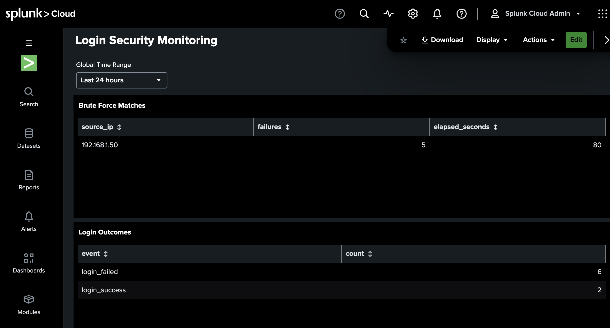
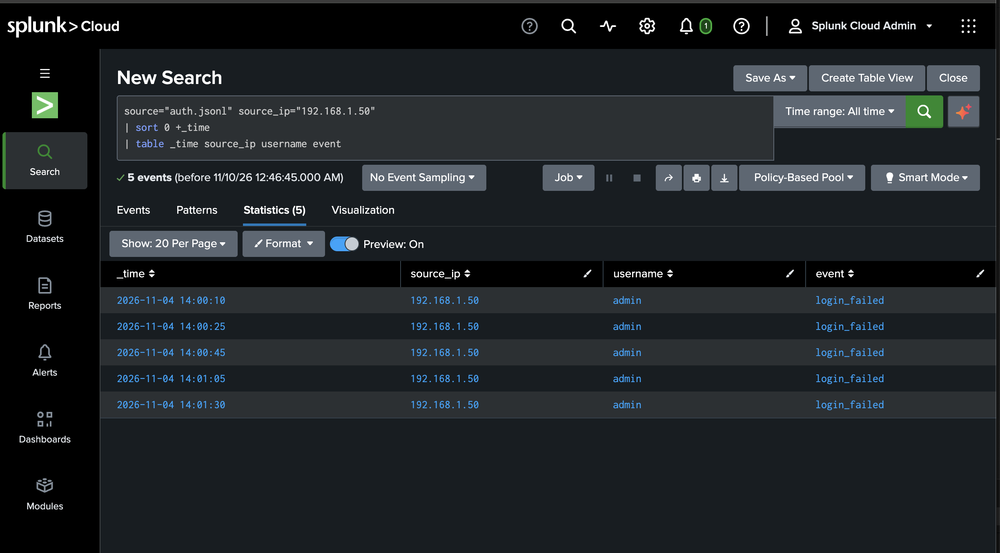

## Splunk Brute-Force Detection Demo

I used Splunk Cloud to reproduce the rule from my Python detector: flag a source IP when it reaches five failed logins within a rolling two-minute window.

### Dashboard results

The sample contains eight login events: six failed logins and two successful logins. Splunk flagged `192.168.1.50` after five failures in 80 seconds, matching the Python detector on the same sample.



### Investigation

I searched all login events from the flagged IP and sorted them by time. The timeline showed five failed attempts against `admin` and no successful logins from that IP in the sample.



### Reproduce the detection

1. Upload `sample_logs/auth.jsonl` to Splunk using the `_json` source type.
2. Open **Search & Reporting**, set the time range to **All time**, and run:

```spl
source="auth.jsonl" event="login_failed"
| sort 0 +_time
| streamstats time_window=2m count AS failures min(_time) AS first_failure BY source_ip
| where failures=5
| eval elapsed_seconds=_time-first_failure
| table source_ip failures elapsed_seconds
```

Expected result: one match for `192.168.1.50`, with `failures=5` and `elapsed_seconds=80`.

I also tested the time limit by doubling the gaps between events in the search. The five failures then spanned 160 seconds, and Splunk returned no match.